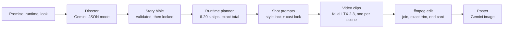

# AIFLIX Studio

Write a premise, pick a length and a look: an AI pipeline plans, shoots and edits a short film with its own cast and poster.

[](https://github.com/Brok3nnn/aiflix-studio/actions/workflows/ci.yml)
[](LICENSE)
[](https://nodejs.org/)

## Overview

AIFLIX Studio is a local, single-user web app. You describe a film in a few sentences, choose a
runtime (8 to 480 seconds) and a look (realistic or animated). The studio then:

- has a director model write a **story bible**: synopsis, cast, locations and a scene timeline;
- splits the runtime into scenes whose clip lengths add up to it **exactly**;
- renders **one video clip per scene** with the style and cast locked into every prompt;
- **edits** the clips into one film with ffmpeg and adds an end card;
- generates a **poster** from the same locked plan.

Features:

- **Mock mode** (the default): the whole pipeline runs offline with no API keys and no cost.
- **Result view**: the finished film, the poster, the synopsis, the cast and the scene list with
  each scene's length, next to a live job monitor.
- **Failure handling**: retries with backoff, `Retry-After`, model fallback chains, resumable
  jobs and recovery of jobs interrupted by a restart.
- **Cost guards**: one running job at a time and a cap on clips per job, both configurable.

## Architecture



The browser client (vanilla TypeScript, Vite) talks to a small Express API. A job runs inside
the API process: each step writes its progress and log lines to the film record, which the
client polls. Films are stored behind a repository interface (MongoDB or in memory); media goes
to a local folder that the API serves at `/media`. Providers sit behind three interfaces
(director, video, poster), so the live Gemini and fal.ai providers and the offline mock providers
are interchangeable.

## How it works

| Step               | What happens                                                                                                                                                                                                                           | Code                                                                                                                   |
| ------------------ | -------------------------------------------------------------------------------------------------------------------------------------------------------------------------------------------------------------------------------------- | ---------------------------------------------------------------------------------------------------------------------- |
| 1. Director plan   | Gemini in JSON mode writes the story bible for exactly the planned number of scenes. The answer is validated field by field; anything missing or malformed gets a usable default, and the cast is topped up to the requested minimums. | [`director.ts`](server/src/studio/director.ts), [`providers/gemini.ts`](server/src/studio/providers/gemini.ts)         |
| 2. Locked pass     | A second, low-temperature call rewrites the synopsis and the poster direction using only facts from the plan, so neither promises something the film does not show. If it fails, both are built from the plan instead.                 | [`director.ts`](server/src/studio/director.ts)                                                                         |
| 3. Runtime planner | Splits the runtime into clip lengths (below).                                                                                                                                                                                          | [`shared/planner.ts`](shared/planner.ts)                                                                               |
| 4. Shot prompts    | One prompt per scene with the style lock and character lock, kept within a 5,000-character budget.                                                                                                                                     | [`prompts.ts`](server/src/studio/prompts.ts)                                                                           |
| 5. Clips           | One `POST https://fal.run/fal-ai/ltx-2.3/text-to-video/fast` per scene: 1080p, 16:9, 25 fps, with audio. Clips are written under a temporary name and renamed when complete.                                                           | [`providers/fal.ts`](server/src/studio/providers/fal.ts), [`jobs/pipeline.ts`](server/src/studio/jobs/pipeline.ts)     |
| 6. Edit            | One ffmpeg pass normalises the clips, concatenates them, pads or trims to the exact runtime, fades picture and sound over the last seconds and draws the end card text with a bundled font.                                            | [`editor/commands.ts`](server/src/studio/editor/commands.ts), [`editor/runner.ts`](server/src/studio/editor/runner.ts) |
| 7. Poster          | Gemini image output from a prompt built only from the locked plan. A failed poster does not fail the film.                                                                                                                             | [`poster.ts`](server/src/studio/poster.ts), [`providers/gemini.ts`](server/src/studio/providers/gemini.ts)             |

Jobs are started, resumed and limited by [`jobs/runner.ts`](server/src/studio/jobs/runner.ts),
and the request is validated with zod in [`http/validation.ts`](server/src/http/validation.ts).

### The exact-runtime planner

The video model accepts clips of 6 to 20 seconds in 2-second steps, so the runtime must be an
even number of seconds. For a runtime of `T` seconds:

1. **Scene count** = `round(T / 14)`, kept within `ceil(T / 20)` to `floor(T / 6)` so every scene
   can be between 6 and 20 seconds.
2. Every scene starts at **6 seconds**.
3. The remaining time is shared out in **2-second units**, in proportion to each scene's
   `durationWeight` (1 to 5), which the director sets: heavier dramatic scenes get longer clips.
4. **No scene goes over 20 seconds.** A scene that would is capped and its excess is shared among
   the others; fractional shares are rounded with the largest-remainder method.

Example: 64 seconds gives 5 scenes. 5 × 6 s = 30 s, leaving 34 s (17 units). With weights
`[2, 3, 4, 3, 5]` the scenes are `10 + 12 + 14 + 12 + 16 = 64` seconds. The tests check every valid
runtime from 8 to 480 seconds against many weight mixes. The planner is shared with the web
client, which previews the split before you submit.

### Consistency, and its limits

Consistency between clips is **text-only**. Every shot prompt carries:

- a **style lock**: one medium (live action or animation) and one look, with the drift the
  director banned for this film;
- a **character lock**: face, build, wardrobe and signature details of everyone on screen (at
  most three named characters per scene).

There are no reference images and no seeds, so **faces, wardrobe and look can still drift
between scenes**. The locks reduce drift; they do not remove it.

### Failure handling

- **Retries with backoff**: network errors and 5xx responses are retried up to 3 times (2 s, 4 s,
  8 s).
- **Rate limits**: a 429 is retried up to 8 times. The wait is the `Retry-After` header (fal.ai)
  or Gemini's `RetryInfo` delay, else 30 s; no single wait is longer than 2 minutes. Each retry is
  written to the job log before the wait, so the UI shows it.
- **Model fallback chains**: the director tries `STUDIO_SCRIPT_MODEL` (default
  `gemini-2.5-flash`), then `gemini-3-flash-preview`, then `gemini-3.1-pro-preview`. The poster
  tries `STUDIO_POSTER_MODEL` (default `gemini-2.5-flash-image`), then
  `gemini-3.1-flash-image-preview`. The next model is tried only when one is unavailable,
  rate-limited, retired or returns nothing usable; never after a content-policy refusal or an
  authentication error.
- **Resumable jobs**: the validated plan, scene lengths and locked copy are saved as
  `plan-snapshot.json` before the first paid video call. **Resume** reloads that plan, reuses
  every clip already on disk and renders only the rest. The requested runtime is never changed by
  a failure, so the resumed film has every scene.
- **Restarts**: jobs run inside the server process. On start-up, films still marked as rendering
  are marked as failed with the reason "interrupted", and can be resumed.
- **Content policy**: if a provider refuses a prompt under its content policy, that scene fails
  with a message that names it, for example
  `Scene 3 ("The Ambush") was rejected by fal.ai's content policy`. Such a failure is not
  retried and cannot be resumed. **The studio never rewrites a prompt to get past a provider's
  safety filter**; change the premise and start a new film. Requests to fal.ai also send
  `enable_safety_checker: true` explicitly.

### Cost

In live mode, a film of `T` seconds makes:

- **round(T / 14) video clips** (clamped as above), one fal.ai call each: 5 clips for 64 s, 34 for
  480 s;
- **about 3 Gemini calls**: the story plan, the locked pass and the poster.

Retries and model fallbacks can add calls. Prices change, so see the providers' pages:
[fal.ai LTX 2.3 Fast](https://fal.ai/models/fal-ai/ltx-2.3/text-to-video/fast),
[fal.ai pricing](https://fal.ai/pricing) and
[Gemini API pricing](https://ai.google.dev/gemini-api/docs/pricing). The form shows the clip count
before you submit. By default the server runs one job at a time and allows at most 12 clips per
film (up to 174 seconds); raise `STUDIO_MAX_CLIPS_PER_JOB` for longer films.

**Mock mode costs nothing**: a deterministic story bible built from your premise, placeholder
clips rendered locally with ffmpeg (a coloured field, a tone and the scene title) and a
placeholder poster. It runs the same pipeline, edit and end card included.

## Design decisions and trade-offs

- **Mock providers by default.** Paid calls are opt-in (`STUDIO_PROVIDERS=live`), and a reviewer
  can run everything without keys.
- **In-memory store for the demo, MongoDB for real runs.** With no `MONGO_URI` the studio needs
  no database; films then disappear on restart (their media stays on disk). Both stores implement
  the same small repository interface; the tests use the in-memory one.
- **Jobs run in the API process.** Simple and enough for one user, but a restart stops a job.
  Snapshots, atomic clip files and start-up recovery make that a resumable failure rather than
  a lost one. A queue would be the next step for more users.
- **Exact runtime first.** The planner only produces lengths the model accepts, and the editor
  pads or trims to the frame, so a 64-second request yields a 64-second film.
- **One ffmpeg pass for the edit** (normalise, join, trim, fade, text). The commands are built by
  pure functions and unit-tested; option values are escaped for ffmpeg's filtergraph syntax.
- **End card over the last seconds, not after them.** The picture fades to black over the final
  `min(5, T/4)` seconds and the text appears there, so the runtime stays exact.
- **The requested brief is immutable.** Jobs can only update fields that describe progress and
  results; the type system rejects a patch that touches the runtime.
- **Text-only consistency.** No reference images or seeds: cheaper and simpler, at the cost of
  some drift between clips.
- **The synchronous fal.ai endpoint.** One request per clip that returns when the clip is ready.
  The queue API would survive long renders better (see the roadmap).

## Tech stack

- **Server:** Node.js 24 (runs the TypeScript directly), Express 5, zod, Mongoose, the
  `@google/genai` SDK and fal.ai's HTTP API.
- **Media:** ffmpeg and ffprobe; DM Serif Display (SIL Open Font License) for the end card.
- **Client:** TypeScript and Vite, no framework.
- **Quality:** strict TypeScript (no `any`), ESLint with typescript-eslint, Prettier, Vitest,
  GitHub Actions.

## Getting started

You need **Node.js 24** and **ffmpeg** (with ffprobe) on your `PATH`.

### 1. Mock mode (no keys, no cost)

```bash
git clone https://github.com/Brok3nnn/aiflix-studio.git
cd aiflix-studio
npm ci
npm run dev
```

Open http://127.0.0.1:5173, write a premise and press **Generate film**. No `.env` is needed:
the studio uses the mock providers and keeps films in memory. Generated media goes to
`generated/`.

> **Text on the end card needs ffmpeg's `drawtext` filter** (ffmpeg built with libfreetype).
> Ubuntu and Debian packages include it. Homebrew's default `ffmpeg` formula does not: the studio
> still works, but the end card and placeholder titles have no text, and the server and job
> logs say so.
> For text on macOS, `brew install ffmpeg-full` and set
> `FFMPEG_PATH=$(brew --prefix ffmpeg-full)/bin/ffmpeg` and
> `FFPROBE_PATH=$(brew --prefix ffmpeg-full)/bin/ffprobe` in `.env`.

### 2. Live mode (paid API calls)

```bash
cp .env.example .env
# Set GOOGLE_API_KEY, FAL_KEY and STUDIO_PROVIDERS=live in .env.
docker compose up -d mongo   # MongoDB at the MONGO_URI from .env.example
npm run dev
```

To skip MongoDB in live mode, leave `MONGO_URI` empty; films are then kept in memory.

### 3. Production build

```bash
npm run build   # builds the web client into dist/
npm start       # serves the API and the client on http://127.0.0.1:3001
```

## Configuration

All variables are optional; see [`.env.example`](.env.example). Empty values use the default.

| Variable                     | Default                  | Purpose                                                                         |
| ---------------------------- | ------------------------ | ------------------------------------------------------------------------------- |
| `GOOGLE_API_KEY`             | (empty)                  | Gemini key for the director, the locked pass and the poster. Live mode only.    |
| `FAL_KEY`                    | (empty)                  | fal.ai key for the video clips. Live mode only.                                 |
| `MONGO_URI`                  | (empty: in-memory store) | MongoDB connection string. `.env.example` points at the docker compose service. |
| `HOST`                       | `127.0.0.1`              | API address. Keep it on loopback: there is no authentication.                   |
| `PORT`                       | `3001`                   | API port. The Vite dev server proxies `/api` and `/media` to it.                |
| `GENERATED_DIR`              | `generated`              | Folder for clips, films, posters and plan snapshots.                            |
| `STUDIO_SCRIPT_MODEL`        | `gemini-2.5-flash`       | First model of the director's fallback chain.                                   |
| `STUDIO_POSTER_MODEL`        | `gemini-2.5-flash-image` | First model of the poster's fallback chain.                                     |
| `STUDIO_PROVIDERS`           | `mock`                   | `mock` (offline, free) or `live` (Gemini and fal.ai, paid; needs both keys).    |
| `STUDIO_MAX_CONCURRENT_JOBS` | `1`                      | Films that may render at the same time.                                         |
| `STUDIO_MAX_CLIPS_PER_JOB`   | `12`                     | Most clips (paid video calls) per film. 12 allows up to 174 s; 480 s needs 34.  |
| `STUDIO_END_CARD_TEXT`       | `AIFLIX Studio`          | Text on the end card.                                                           |
| `FFMPEG_PATH`                | `ffmpeg`                 | ffmpeg executable.                                                              |
| `FFPROBE_PATH`               | `ffprobe`                | ffprobe executable.                                                             |

## Testing and quality checks

```bash
npm test               # Vitest: 94 tests, no network, no API keys
npm run test:coverage  # with coverage (about 81% of statements)
npm run check          # lint, format check, type check (server and client) and tests
```

The tests cover the runtime planner (every valid runtime, the 6-20 s bounds, weights and edge
cases), director JSON validation and defaults, prompt budgeting, request validation, the ffmpeg
command builders (including escaping, checked against ffmpeg's own parser), retries and
`Retry-After`, provider error handling, the duration-overwrite regression, start-up recovery,
the content-policy path, the HTTP API, and one end-to-end run with the mock providers, the
in-memory store and the real ffmpeg. The end-to-end test is skipped, with a message, when ffmpeg
is not installed; CI installs ffmpeg and always runs it. The MongoDB repository is type-checked
but has no automated test, because the tests must not need a database or the network.

CI ([`ci.yml`](.github/workflows/ci.yml)) runs `npm run check` and `npm run build` on Node 24 with
ffmpeg installed.

## Project structure

```text
aiflix-studio/
├── .github/            CI workflow, Dependabot, issue and pull request templates
├── assets/fonts/       DM Serif Display and its OFL licence (end card, headings)
├── server/
│   ├── src/            API, config, store and the studio pipeline (studio/)
│   └── test/           Vitest suites and test helpers
├── shared/
│   ├── api.ts          Types shared by the API and the client
│   └── planner.ts      Exact-runtime planner (used by both)
├── web/
│   ├── index.html      Client entry page
│   ├── public/         Favicon
│   └── src/            Studio page: form, job monitor, film list and result view
├── docker-compose.yml  Local MongoDB
├── .env.example        Every setting, with comments
└── package.json        Scripts and dependencies
```

Inside `server/src/studio/`: `director.ts`, `prompts.ts`, `poster.ts`, `editor/` (ffmpeg command
builders and runner), `providers/` (Gemini, fal.ai, mock, retries) and `jobs/` (pipeline,
runner, progress, snapshots, recovery).

## Status and limitations

Version 1.0.0. It works end to end in mock mode and in live mode with valid keys.

- **One job at a time** by default (configurable), and jobs run inside the API process.
- **Single user, no authentication.** It is a local tool: the server binds to `127.0.0.1` and
  refuses requests addressed to other host names. Add authentication before exposing it on a
  network.
- **The providers' content policies apply.** A refused scene fails the film; prompts are never
  rewritten to get around a refusal.
- **Generated media stays on local disk** in `GENERATED_DIR`. Deleting a film in the studio
  deletes its folder; nothing is uploaded anywhere except the prompts sent to the providers.
- **Consistency is text-only**, so faces and look can drift between scenes.
- Without MongoDB, films are lost when the server restarts (their media stays on disk).

## Roadmap

Planned, not implemented:

- Reference images per character to reduce drift between scenes.
- fal.ai's queue API instead of the synchronous endpoint, for long renders.
- Re-rendering a single scene of a finished film.
- Authentication and per-user quotas, for use beyond one machine.

## Licence

[MIT](LICENSE) © 2026 Balint Vitan.

The bundled font [DM Serif Display](https://github.com/google/fonts/tree/main/ofl/dmserifdisplay)
is licensed under the SIL Open Font License 1.1; see
[`assets/fonts/OFL.txt`](assets/fonts/OFL.txt).

## About

Built by [Balint Vitan](https://github.com/Brok3nnn), with AI-assisted tooling.
